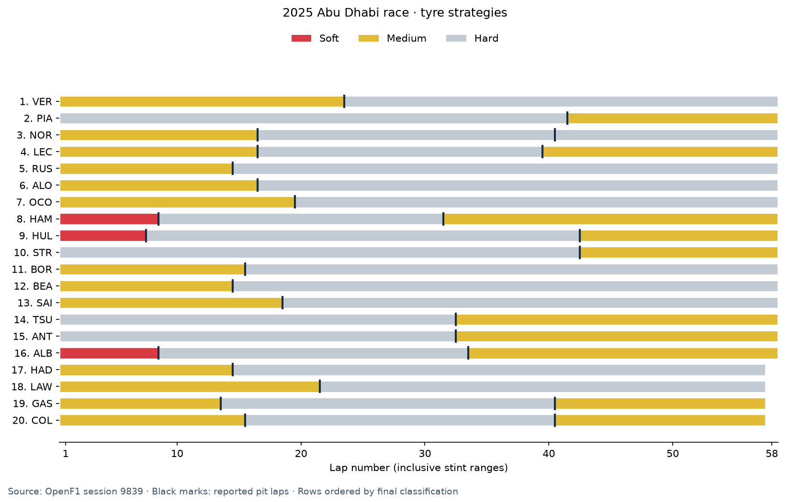

# Process-mining findings

Computed from the exported OCEL by `scripts/analyze_ocel.py`; see `insights.json` for exact values and `race-entry-traces.json` for the 20 event-ID traces.

The 20 drivers used 5 compound-sequence variants. Thirteen drivers made one stop and seven made two. Norris's MEDIUM → HARD → HARD sequence retains two distinct hard-tyre stints; a compound-only state model would hide the second stop.

| Strategy | Drivers |
|---|---:|
| MEDIUM → HARD | 9 |
| HARD → MEDIUM | 4 |
| MEDIUM → HARD → HARD | 1 |
| MEDIUM → HARD → MEDIUM | 3 |
| SOFT → HARD → MEDIUM | 3 |

Pit-lane duration across 27 observations: median 21.799 s, range 20.902–28.369 s. Stationary duration across 26 observations: median 2.500 s, range 2.000–8.900 s. The missing stationary duration (Hülkenberg, lap 7) stays missing. Pit-lane duration is not counterfactual race-time loss.

There are 39 distinct deleted lap times in 40 notifications, 25 messages mentioning multiple drivers, six announced time penalties and two later 'penalty served' notifications. These are message timestamps, not the physical times of the underlying infringements or penalty service. The two Leclerc lap-52 deletion messages refer to the same lap and remain distinct notifications.

The OCEL exposes 95 race-control messages on individual driver traces. The other messages remain session context. Global weather and flags are not copied onto all 20 drivers, avoiding artificial synchronization in the driver process model.

| Finish | Driver | Strategy | Pit laps | Filtered laps | Median filtered lap (s) |
|---:|---|---|---|---:|---:|
| 1 | VER | MEDIUM → HARD | 23 | 53 | 88.455 |
| 2 | PIA | HARD → MEDIUM | 41 | 54 | 89.261 |
| 3 | NOR | MEDIUM → HARD → HARD | 16, 40 | 53 | 88.226 |
| 4 | LEC | MEDIUM → HARD → MEDIUM | 16, 39 | 51 | 88.471 |
| 5 | RUS | MEDIUM → HARD | 14 | 55 | 89.377 |
| 6 | ALO | MEDIUM → HARD | 16 | 55 | 89.968 |
| 7 | OCO | MEDIUM → HARD | 19 | 54 | 89.674 |
| 8 | HAM | SOFT → HARD → MEDIUM | 8, 31 | 50 | 89.258 |
| 9 | HUL | SOFT → HARD → MEDIUM | 7, 42 | 50 | 89.483 |
| 10 | STR | HARD → MEDIUM | 42 | 54 | 89.995 |
| 11 | BOR | MEDIUM → HARD | 15 | 53 | 90.058 |
| 12 | BEA | MEDIUM → HARD | 14 | 54 | 89.715 |
| 13 | SAI | MEDIUM → HARD | 18 | 54 | 89.796 |
| 14 | TSU | HARD → MEDIUM | 32 | 53 | 90.057 |
| 15 | ANT | HARD → MEDIUM | 32 | 52 | 90.058 |
| 16 | ALB | SOFT → HARD → MEDIUM | 8, 33 | 50 | 89.707 |
| 17 | HAD | MEDIUM → HARD | 14 | 52 | 90.169 |
| 18 | LAW | MEDIUM → HARD | 21 | 52 | 89.641 |
| 19 | GAS | MEDIUM → HARD → MEDIUM | 13, 40 | 48 | 89.882 |
| 20 | COL | MEDIUM → HARD → MEDIUM | 15, 40 | 49 | 89.841 |

Lap summaries exclude lap 1, pit-in laps, pit-out laps and retrospectively deleted times. Compound comparisons remain confounded by driver, fuel load, traffic, tyre age and race phase; these data do not prove an optimal strategy or a causal tyre effect. All drivers finished; this single race has no observed retirement pathway.

For process discovery, select `RaceEntry` as the leading object type. `TyreStint` exposes lap progression and transitions; `Team` exposes two concurrent entries and should not be flattened as one sequential case. Pit events qualify outgoing and incoming stints, even when compounds match. `Lap` supports linking delayed deletion notifications to the affected lap.

The PM4Py object-centric directly-follows graph and 20 flattened entry traces were computed successfully. The JSON report also provides a directly-follows summary excluding adjacent equal-timestamp pairs. Equal timestamps have no defined causal order; approximate lap-boundary timestamps may interleave with first-lap stint markers.

For as-of state analysis, read the timed attributes in the OCEL JSON directly. PM4Py promotes the first value of each object attribute to its static table, including future deletion observations and final-result snapshots. Do not use those static values as pre-race prediction features.
